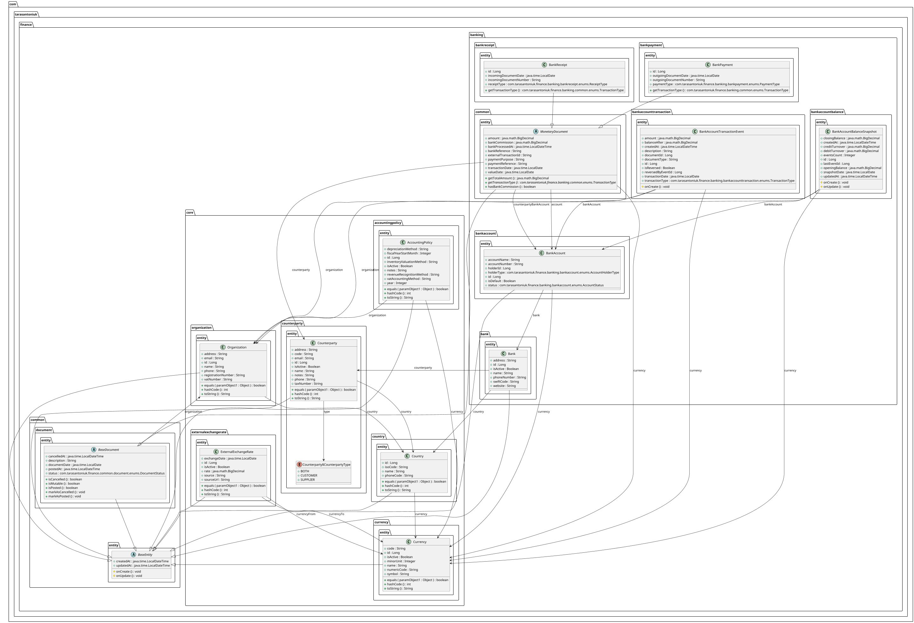
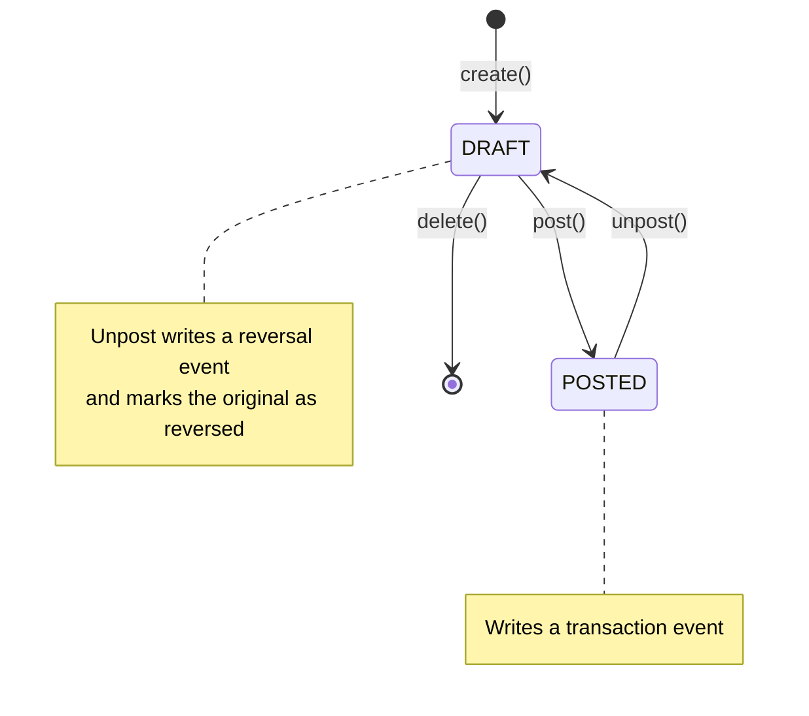
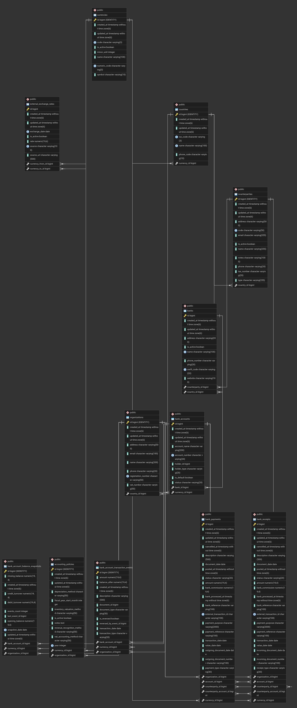

# System Architecture

## Overview

**Modular monolith** with clear separation between foundation (Core), business logic (Banking), and security (Security).

### Key Principles

- **Unidirectional Dependency** — Banking depends on Core, Core is independent
- **Event Sourcing** — Every posting is recorded as an event; corrections are reversal events, never deletes
- **Layered Structure** — entity → repository → service → controller in every module
- **JWT Security** — Stateless authentication with role-based access control and organization-scoped reads

---

## Module Structure
```
com.tarasantoniuk.finance
│
├── common/                   (Shared Infrastructure)
│   ├── entity/BaseEntity     createdAt, updatedAt, createdBy, updatedBy
│   ├── document/BaseDocument documentDate, status, organization
│   ├── config/               JPA auditing, provisioning properties
│   ├── swagger/              OpenAPI customisation
│   ├── period/               Report period calculation
│   ├── snapshot/             Snapshot validity tracking
│   ├── debug/                Hibernate statistics (dev profile only)
│   └── GlobalExceptionHandler, ErrorResponse
│
├── core/                     (Foundation Module - Independent)
│   ├── country/              Country registry
│   ├── organization/         Organizations
│   ├── counterparty/         Customer/supplier registry (shared across organizations)
│   ├── currency/             ISO 4217 currencies + data loader
│   ├── accountingpolicy/     Fiscal year policies
│   └── externalexchangerate/ ECB integration + exchange rates
│       └── source/ecb/       ECBScheduler, ECBClient, ECBSyncService
│
├── banking/                  (Transaction Module - Depends on Core)
│   ├── common/               MonetaryDocument base, InsufficientBalanceException
│   ├── bank/                 Bank registry
│   ├── bankaccount/          Multi-currency accounts
│   ├── bankreceipt/          Incoming payments (7 types)
│   ├── bankpayment/          Outgoing payments (10 types)
│   ├── bankaccounttransaction/  Event store
│   ├── bankaccountbalance/   Balance calculation, daily snapshots, nightly jobs
│   └── report/               Financial reports
│       ├── accountbalance/   Balance reports
│       └── accountturnover/  Turnover reports
│
└── security/                 (Security Module - Cross-cutting)
    ├── auth/                 Register, login, Google sign-in, refresh, logout; per-client rate limit
    ├── jwt/                  JWT generation & validation, JwtAuthenticationFilter
    ├── user/                 User entity, admin management, revocation
    ├── token/                Refresh tokens, token blacklist
    ├── config/               SecurityFilterChain, CORS, 401/403 handlers
    └── audit/                Security event logging
```

### Module Dependencies
```
Security Module (cross-cutting, protects all endpoints)
    ↓
Banking Module
    ↓ uses
Core Module (Country, Organization, Counterparty, Currency, AccountingPolicy, ExternalExchangeRate)
    ↓ uses
Common Infrastructure (BaseEntity, BaseDocument, SnapshotValidity)
```

**Rule**: Banking → Core → Common (unidirectional only). Security is cross-cutting.

---

## Domain Model



*[View PlantUML source](uml/domain-model.puml)*

### Entity Hierarchy
```
BaseEntity (audit fields: createdAt, updatedAt, createdBy, updatedBy)
    ↓
BaseDocument (status: DRAFT / POSTED / CANCELLED)
    ↓
MonetaryDocument (account, amount, currency, counterparty)
    ├── BankReceipt (incoming payments)
    └── BankPayment (outgoing payments)

User (email, password, role, organization, lockout tracking)
RefreshToken (tokenHash, expiresAt, revoked, used)
BlacklistedToken (jti, expiresAt)
SecurityAuditEntry (action, email, ip, occurredAt)

BankAccountTransactionEvent (event store)
BankAccountBalanceSnapshot (daily balance snapshot)
SnapshotValidity (marks snapshots stale after backdated events)
```

### Key Entities

**Core Module (Foundation):**
- `Country` — Country registry with ISO codes and currency references
- `Organization` — Legal entities with registration details; every scoped record belongs to one
- `Counterparty` — Customer/supplier registry with tax identification. Deliberately global: the same supplier is shared by several organizations; visibility comes from the scoped documents that reference it
- `Currency` — ISO 4217 codes, symbols, minor units (decimal precision)
- `AccountingPolicy` — Fiscal year policies per organization
- `ExternalExchangeRate` — Daily rates from ECB (190k+ records)

**Banking Module (Transactions):**
- `Bank` — Bank registry with SWIFT codes
- `BankAccount` — Multi-currency accounts with holder types (ORGANIZATION/COUNTERPARTY). Only organization accounts carry events and snapshots; counterparty accounts are reference data on documents
- `BankReceipt` — 7 receipt types (CUSTOMER_PAYMENT, LOAN_RECEIVED, INVESTMENT, REFUND, INTEREST_INCOME, INTERNAL_TRANSFER, OTHER_INCOME)
- `BankPayment` — 10 payment types (SUPPLIER_PAYMENT, SALARY, TAX_PAYMENT, LOAN_REPAYMENT, CONTRACTOR_PAYMENT, UTILITY_PAYMENT, RENT, REFUND, INTERNAL_TRANSFER, OTHER)
- `BankAccountTransactionEvent` — One event per posting or reversal
- `BankAccountBalanceSnapshot` — End-of-day balance and turnovers per account

**Security Module (Authentication & Authorization):**
- `User` — Email (unique), encoded password, role (ADMIN/USER/GUEST), organization FK, lockout fields
- `RefreshToken` — Token hash, expiration, revoked/used flags
- `BlacklistedToken` — `jti` of logged-out access tokens until they expire
- `SecurityAuditEntry` — Persisted security events

---

## Security Architecture

### Authentication Flow
```
Client                          Server
  |                               |
  |-- POST /api/auth/login ------>|
  |   {email, password}           |-- Per-client rate limit (5/60s per address)
  |                               |-- Validate credentials, check lockout
  |                               |-- Generate JWT access token (15 min)
  |                               |-- Generate refresh token (7 days), store its hash
  |                               |-- Publish audit event
  |<-- 200 {accessToken} ---------|
  |   Set-Cookie: refresh_token   |
  |   (HttpOnly, Secure, Strict,  |
  |    Path=/api/auth/refresh)    |
  |                               |
  |-- GET /api/... -------------->|
  |   Authorization: Bearer <jwt> |
  |                               |-- JwtAuthenticationFilter
  |                               |   1. Extract Bearer token
  |                               |   2. Validate signature (HMAC-SHA256) and claims
  |                               |   3. Reject blacklisted jti (Caffeine cache, then DB)
  |                               |   4. Reject revoked users
  |                               |   5. Set JwtPrincipal in SecurityContext
  |<-- 200 response --------------|
```

`POST /api/auth/google` follows the same path after verifying a Google ID token; unknown emails are auto-provisioned as GUEST in the default organization.

### JWT Token Structure
- **Algorithm**: HMAC-SHA256
- **Access Token** (15 min): claims `jti`, `sub` (userId), `email`, `role`, `orgId`, `iss`
- **Refresh Token** (7 days): never in a response body; HttpOnly, Secure, SameSite=Strict cookie scoped to `/api/auth/refresh`

### Security Filter Chains
1. **Public chain** (Order=1): `/swagger-ui/**`, `/swagger-ui.html`, `/v3/api-docs/**`, `/api-docs/**`, `/webjars/**`, `/actuator/health`, `/error` — permitted without authentication
2. **Main API chain** (Order=2): stateless JWT authentication

### Authorization Rules
| Endpoint Pattern | HTTP Method | Required Role |
|---|---|---|
| `/api/auth/register`, `/login`, `/google`, `/refresh` | POST | None (public) |
| `/api/auth/logout`, `/api/auth/change-password` | POST | Any authenticated |
| `/api/exchange-rates/latest/{date}` | GET | None (public) |
| `/api/admin/**` | Any | ADMIN |
| Master data: `/api/banks/**`, `/api/currencies/**`, `/api/countries/**`, `/api/exchange-rates/**` | GET | Any authenticated |
| Master data | POST/PUT/PATCH/DELETE | ADMIN |
| `/api/organizations/**` | GET | Any authenticated |
| `/api/organizations/**` | PUT/PATCH | USER or ADMIN (USER: own organization only, enforced in the service) |
| `/api/organizations/**` | POST/DELETE | ADMIN |
| Operational data: counterparties, accounting policies, bank accounts, receipts, payments | GET | Any authenticated |
| Operational data | POST/PUT/PATCH | USER or ADMIN |
| Operational data | DELETE | ADMIN |
| Anything else under `/api/**` | Any | Any authenticated |

### Organization Scoping

Endpoint roles alone do not stop a USER from reading another organization's data. Reads in `OrganizationService`, `BankAccountService`, `BankAccountBalanceService`, `BankAccountTransactionService`, `BankReceiptService`, `BankPaymentService`, `AccountingPolicyService`, `AccountBalanceReportService` and `AccountTurnoverReportService` are filtered by the caller's active organization. ADMIN is unrestricted; a caller without an active organization gets 403. Filtering uses explicit `organizationId` arguments in repository queries.

### Error Semantics
- **401** — no valid identity: missing, expired, blacklisted or revoked token; missing or invalid refresh cookie
- **403** — valid identity, insufficient rights: role mismatch or a service-layer denial such as cross-organization access
- **400 / 415 / 409** — malformed body, unsupported media type, data conflict; framework exceptions keep their own status
- **500** — unexpected errors only; logged with stack trace, the response carries a generic message

### Security Features
- **Account Lockout**: 5 failed login attempts = 30-minute lock
- **Rate Limiting**: 5 requests per 60 s on register, login and Google sign-in, **per client address**. The client address comes from Tomcat's `RemoteIpValve` (`server.request.header.forwarded.strategy=web-server`), which trusts `X-Forwarded-For` only through internal proxies
- **Token Blacklist**: logged-out `jti` values in the database, cached in Caffeine (15 min, 10K entries)
- **User Revocation**: a role change or deactivation revokes the user's access tokens (in-memory, 15 min) and refresh tokens (database)
- **Password Validation**: strength requirements on registration and change
- **Security Headers**: X-Frame-Options: DENY, HSTS (1 year), CSP `default-src 'self'; frame-ancestors 'none'`, X-Content-Type-Options: nosniff
- **CORS**: configurable origins; allowed headers `Authorization` and `Content-Type`
- **Audit Events**: login success/failure, registration, logout, account lockout

---

## Core Module: Foundation Entities

### ECB Integration (Automated Exchange Rates)

```
ECBScheduler (@Scheduled: 0 5 16 * * *, Europe/Paris)
    ↓
ECBClient (RestClient, HTTP GET XML feed, 10 s connect / 30 s read timeout)
    ↓
ECBSyncService (parse XML → batch insert)
    ↓
ExternalExchangeRate (190k+ records)
```

1. **Daily Trigger** — 16:05 CET, after ECB publishes rates
2. **Download XML** — ECB daily or historical feed
3. **Parse & Validate** — 40+ currency rates
4. **Batch Insert** — idempotent; a unique constraint on `(exchange_date, currency_from_id, currency_to_id, source)` prevents duplicates
5. **Startup** — loads the historical feed when the table is empty; `ecb.sync.enabled=false` disables syncing
6. **Manual Sync** — `POST /api/admin/external-rate-sync/sync` (ADMIN)

---

## Banking Module: Event Sourcing

### Posting Flow
```
User creates BankReceipt / BankPayment (DRAFT)
    ↓
POST /api/v1/bank-receipts/{id}/post
    ↓
BankReceiptService.post()
    ├── lock the document row (SELECT ... FOR UPDATE), check status = DRAFT
    ├── payments: lock the bank account row, check the balance
    ↓
BankAccountTransactionService.postDocument()
    ├── lock the bank account row
    ├── write BankAccountTransactionEvent (DEBIT for receipts, CREDIT for payments)
    └── invalidate snapshots if the event lands behind an existing snapshot
    ↓
Document status = POSTED
```

Row locks make concurrent requests for the same document or account run one after another: a double-clicked post writes one event, and two payments cannot both pass the balance check.

### Event Store

**Table:** `bank_account_transaction_events`

**Event Fields:**
- `bankAccount`, `organization`, `currency` — context
- `transactionDateTime` — the document's date; backdated documents produce backdated events
- `transactionType` (DEBIT = money in, CREDIT = money out), `amount`
- `documentType`, `documentId` — source document
- `balanceAfter` — balance at insert time (informational; not recalculated for backdated events)
- `isReversed`, `reversedByEventId` — reversal links

**Mutability:** events are never deleted and amounts are never changed. The only update is the reversal link: when a document is unposted, the original event gets `is_reversed = true` and `reversed_by_event_id`.

### Document Lifecycle


- `DRAFT` — editable and deletable, no events
- `post()` → `POSTED` — writes one event
- `unpost()` → `DRAFT` — writes a reversal event with the original date and the opposite type; the original is marked reversed
- Repost after unpost — writes a new event and marks the previous reversal as reversed
- `CANCELLED` exists in `DocumentStatus` but no operation sets it yet

### Balance Calculation

Balance of an account at a moment T:
```
Balance(T) = closing balance of the latest valid snapshot before T
           + Σ DEBIT amounts − Σ CREDIT amounts of events after the snapshot and before T
```
Events with `is_reversed = true` and reversal events themselves are excluded, so an unposted document contributes nothing.

### Daily Snapshots

- A snapshot of day D is stored at D+1 00:00 with opening balance, debit and credit turnovers and closing balance.
- **00:30** — `createDailySnapshots` creates yesterday's snapshot for every active organization account.
- **Invalidation** — when an event (post, reversal, repost) lands before an existing snapshot, a `snapshot_validity` row marks that snapshot and all later ones stale. Until they are rebuilt, balance calculation ignores them.
- **01:00** — `recalculateInvalidSnapshots` rebuilds stale snapshots from the backdated day onwards.
- Each account is processed in its own transaction: a failure is logged and rolled back for that account only, and its validity row stays for the next run.

---

## Design Decisions

### Why Event Sourcing?

✅ **Complete Audit Trail** — every posting and reversal recorded  
✅ **Temporal Queries** — balance as of any date  
✅ **Reversal Support** — unpost without deleting history

### Why Modular Monolith?

✅ **Simplicity** — single deployable unit  
✅ **Clear Boundaries** — modules can be split later  
✅ **Performance** — no network overhead between modules

### Why JWT (not session-based)?

- **Stateless** — no server-side session storage
- **Scalable** — works across instances without session affinity
- **Flexible** — claims carry role and organization, reducing DB lookups

### Trade-offs

**Pros:**
- Complete transaction history
- Time-travel queries
- Stateless security

**Cons:**
- Event table grows over time (mitigated by daily snapshots)
- Backdated postings require snapshot invalidation and recalculation
- JWT cannot be revoked natively (mitigated by the blacklist and user revocation)

---

## Database Schema

### Entity-Relationship Diagram



The schema is generated by Hibernate (`ddl-auto=update`); there are no migration scripts yet.

### Key Tables

**Core Module:**
- `countries`, `organizations`, `counterparties`, `currencies`, `accounting_policies`
- `external_exchange_rates` — 190k+ historical rates

**Banking Module:**
- `banks`, `bank_accounts`
- `bank_receipts`, `bank_payments` — documents
- `bank_account_transaction_events` — event store
- `bank_account_balance_snapshots` — daily snapshots
- `snapshot_validity` — stale-snapshot markers

**Security Module:**
- `users`, `refresh_tokens`, `blacklisted_tokens`, `security_audit_entries`

### Indexes

As declared on the entities:
- `external_exchange_rates` — unique `(exchange_date, currency_from_id, currency_to_id, source)`; `(exchange_date, id)`
- `bank_account_transaction_events` — `bank_account_id`; `(document_type, document_id)`; `transaction_date_time`; `created_at`
- `bank_account_balance_snapshots` — `bank_account_id`; `snapshot_date_time`; `(organization_id, snapshot_date_time)`
- `bank_receipts`, `bank_payments` — `account_id`; `counterparty_id`; `external_transaction_id`; `status`; `transaction_date_time`
- `bank_accounts` — `account_number`; `(holder_type, holder_id)`
- `snapshot_validity` — unique `(snapshot_type, entity_id, invalid_from_date)`; `(snapshot_type, entity_id, status)`
- `users(email)`, `refresh_tokens(token_hash)`, `blacklisted_tokens(expires_at)`
- `security_audit_entries` — `action`; `email`; `occurred_at`

Known gaps: there is no composite `(bank_account_id, transaction_date_time)` index for balance queries, and no `organization_id` index on receipts and payments although every scoped list filters by it.

### Sequences

Hibernate sequences with `allocationSize = 50`: `bank_id_seq`, `bank_account_id_seq`, `bank_receipt_id_seq`, `bank_payment_id_seq`, `user_id_seq`, `refresh_token_id_seq`, `security_audit_entry_id_seq`, `external_exchange_rate_id_seq`.

---

## API Structure

All endpoints are documented in [Swagger UI](https://api.tarasantoniuk.com/swagger-ui/index.html).

**Authentication** (`/api/auth`): `register`, `login`, `google`, `refresh`, `change-password`, `logout`

**Admin:** `/api/admin/users`, `/api/admin/external-rate-sync`

**Core Module:** `/api/countries`, `/api/organizations`, `/api/counterparties`, `/api/currencies`, `/api/accounting-policies`, `/api/exchange-rates`

**Banking Module:**
- `/api/banks`, `/api/bank-accounts`
- `/api/v1/bank-receipts`, `/api/v1/bank-payments` — CRUD plus `POST /{id}/post` and `POST /{id}/unpost`
- `/api/v1/banking/reports/account-balances`
- `/api/v1/banking/reports/account-turnovers`, `/api/v1/banking/reports/account-turnovers/{accountId}/details`

**Debug** (`dev` profile only): `/api/debug/hibernate-stats`

---

## Runtime and Deployment

- **Profiles**: `feature` (local), `dev`, `stable` (deployed), `test` (Surefire), `ci` (Maven profile with the coverage gate)
- **CI**: the `Test Coverage` workflow runs on every pull request and on pushes to `dev`
- **CD**: a push to `dev` runs the tests, builds the JAR, copies it to the server and restarts the `finance-app` container with the `stable` profile; the workflow then checks `/actuator/health`
- **Server**: the app container listens on `127.0.0.1:8080`; nginx, certbot and PostgreSQL are shared services in the separate `server-prod` repository and reach the app over the `app-network` Docker network

---

**Version**: 0.0.8-SNAPSHOT  
**Last Updated**: November 2026
